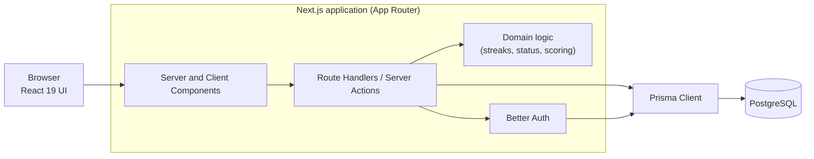

# Architecture

This document describes how the Piano Habit Tracker is structured and why. Individual technology
choices are recorded as [Architecture Decision Records](./adr/README.md).

## Overview

The app is a single full-stack Next.js application. The browser talks only to Next.js, which renders
the UI, exposes the server-side API and talks to PostgreSQL through Prisma.



## Technology stack

| Concern          | Choice                              | Decision record                                       |
| ---------------- | ----------------------------------- | ----------------------------------------------------- |
| Framework        | Next.js (App Router), React 19      | [ADR-0002](./adr/0002-nextjs-app-router-framework.md) |
| Language         | TypeScript (strict)                 | [ADR-0002](./adr/0002-nextjs-app-router-framework.md) |
| Styling / UI     | Tailwind CSS, shadcn/ui             | [ADR-0002](./adr/0002-nextjs-app-router-framework.md) |
| Database and ORM | PostgreSQL, Prisma                  | [ADR-0003](./adr/0003-postgresql-and-prisma.md)       |
| Authentication   | Better Auth                         | [ADR-0004](./adr/0004-better-auth-authentication.md)  |
| Charts           | Recharts                            | [ADR-0005](./adr/0005-recharts-for-charts.md)         |
| Validation       | Zod                                 | Used for environment variables now, API input later   |
| Testing          | Vitest, Testing Library, Playwright | [CONTRIBUTING.md](../CONTRIBUTING.md)                 |
| CI               | GitHub Actions                      | `.github/workflows/ci.yml`                            |

## Source layout

```
src/
  app/            Routes, layouts and pages (App Router). Thin: composes features and components.
    (app)/        Route group for the authenticated app shell (dashboard, scales, ...).
  components/     Shared, feature-agnostic UI.
    ui/           Generated shadcn/ui primitives (do not hand-edit).
    layout/       App shell, navigation, page header.
  features/       One folder per product feature (scales, exercises, dashboard, ...).
  lib/            Generic helpers, including the validated environment loader.
  server/         Server-only code: database access, services, server environment.
e2e/              Playwright end-to-end tests.
docs/             Architecture notes and ADRs.
```

## Layering rules

1. **Pages are thin.** A page composes feature components and fetches data; it holds no business
   rules.
2. **Domain logic is pure TypeScript.** Streak calculation, mastery status and staleness scoring
   live in plain modules with no React or database imports, so they are trivially unit-testable.
3. **Server-only code stays on the server.** Database access and secrets live in `src/server` and
   must never be imported from client components.
4. **Validate at the boundary.** Every API input and every environment variable is parsed with Zod
   before use. Failures return a consistent error shape or stop the app at startup.
5. **Feature folders own their code.** Shared code moves to `src/components` or `src/lib` only when
   a second feature needs it.

## Environment configuration

- `.env.example` documents every variable. Copy it to `.env.local` for development.
- `src/lib/env.ts` parses variables with Zod and throws a clear error at startup when one is
  missing or invalid.
- Secrets will be added in `src/server/env.ts` so they cannot reach the client bundle.

## Database access

- `prisma/schema.prisma` is the single source of truth for the data model. Migrations are generated
  with `npm run db:migrate`, committed to `prisma/migrations`, and applied with `npm run db:deploy`.
- Prisma 7 requires a driver adapter. `src/server/db.ts` creates one shared `PrismaClient` with
  `@prisma/adapter-pg`, kept on `globalThis` in development so hot reloading does not open a new
  connection pool on every change.
- The generated client lives in `src/generated/prisma` and is rebuilt by `postinstall`. It is never
  committed.
- `DATABASE_URL` is validated in `src/server/env.ts`. The server refuses to start without it.
- Only server code imports `@/server/db`. Client components never touch the database.

## API layer

- Endpoints are Next.js route handlers in `src/app/api`, validated with Zod
  ([ADR-0007](./adr/0007-route-handlers-and-zod-api.md)).
  - Shared helpers live in `src/server/api`: `apiHandler`, `ApiError`, the parse helpers, pagination
    and response builders. Logging is in `src/server/logger.ts`, and `requireUser()` in
    `src/server/auth`.
  - Every endpoint returns the same success and error shapes. See
    [api-conventions.md](./api-conventions.md).

## Planned data model

Defined in Epic 2 and refined in its own ADRs:

- **User** with timezone and daily goal.
- **PracticeSession**: one dated block of practice, which feeds the heat map and streaks.
- **Scale** catalog (key and mode), **UserScale** (octaves, hands, target BPM) and
  **ScalePracticeEntry** (clean BPM, max BPM).
- **Exercise** catalog (Hanon 1-60, Czerny, custom), **UserExercise** and
  **ExercisePracticeEntry**.

## Quality gates

Every change goes through the same checks, locally (`npm run verify`, `npm run test:e2e`) and in CI:
Prettier, ESLint with import sorting, `tsc --noEmit`, Vitest with coverage, a production build and
Playwright smoke tests. Husky runs lint-staged and commitlint before each commit.

## Deployment (planned)

Vercel for hosting and a managed PostgreSQL instance (Neon or Supabase) with automated backups.
Migrations run with `prisma migrate deploy` during deployment. Details land in Epic 7.
