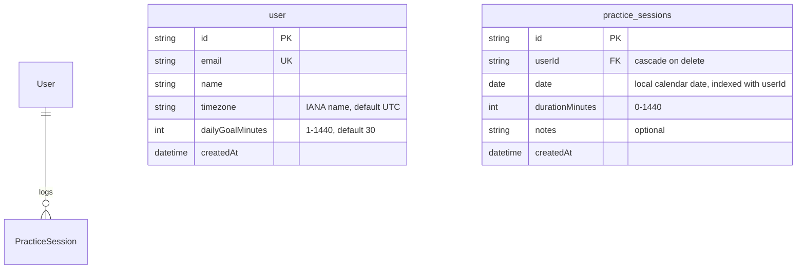

# Entity relationship diagram

Current database model (Epic 2, issue E2-02). The scale and exercise tables are added by E2-03 and
E2-04. Date storage rules are in [ADR-0006](./adr/0006-practice-session-date-storage.md).

