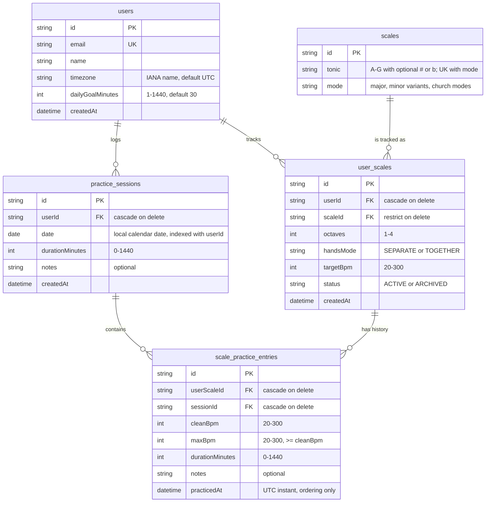

# Entity relationship diagram

Current database model (Epic 2, issues E2-02 and E2-03). The exercise tables are added by E2-04. Date
storage rules are in [ADR-0006](./adr/0006-practice-session-date-storage.md).

`user_scales` is unique on `(userId, scaleId, octaves, handsMode)`, and `scales` is unique on
`(tonic, mode)`.
