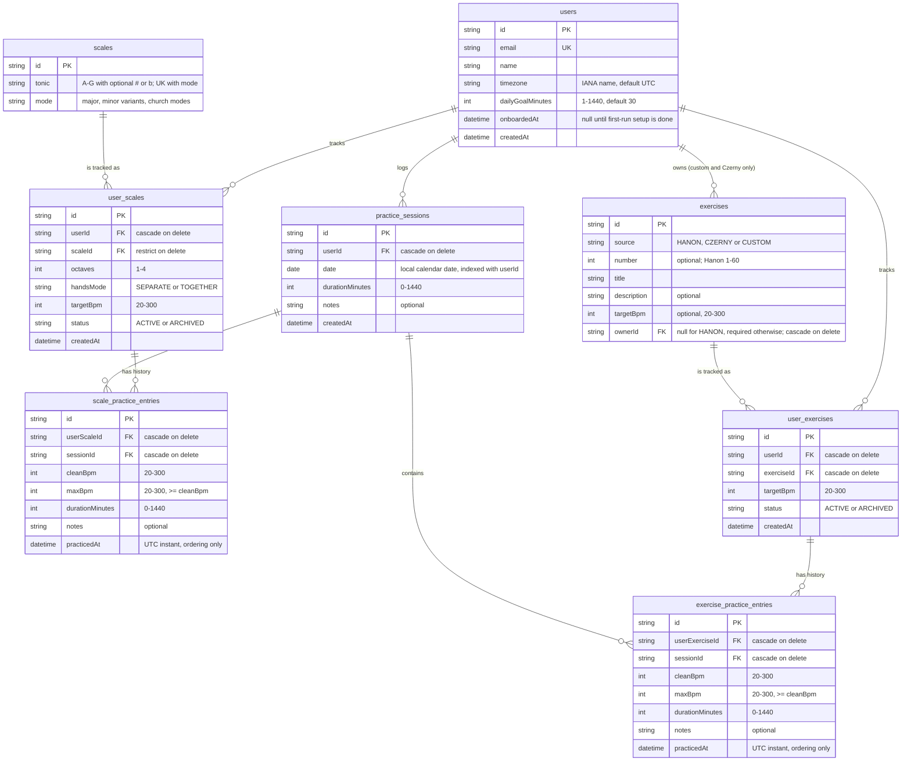

# Entity relationship diagram

Current database model (Epic 2, issues E2-02 to E2-04). Date storage rules are in
[ADR-0006](./adr/0006-practice-session-date-storage.md). How to add catalog exercises is in
[exercise-catalog.md](./exercise-catalog.md).

`user_scales` is unique on `(userId, scaleId, octaves, handsMode)`, and `scales` is unique on
`(tonic, mode)`. `user_exercises` is unique on `(userId, exerciseId)`. `exercises` is unique on
`(ownerId, source, number)` for owned rows, and a partial unique index on `(source, number)` covers
catalog rows, where `ownerId` is null.
